<picture>
  <source media="(prefers-color-scheme: dark)" srcset="assets/desktop-dark.svg">
  <source media="(prefers-color-scheme: light)" srcset="assets/desktop-light.svg">
  
</picture>

### desktop/ — Omarchy & Hyprland

- [omaseafile](https://github.com/FelipeMayerDev/omaseafile) — Seafile in the bar: starts its own daemon and syncs libraries, no desktop client needed
- [omarchy-theme-sync](https://github.com/FelipeMayerDev/omarchy-theme-sync) · [omarchy-vesktop-theme](https://github.com/FelipeMayerDev/omarchy-vesktop-theme) — apps follow the current Omarchy theme live

### self-hosted/

- [fockytv](https://github.com/FelipeMayerDev/fockytv) — low-latency screen sharing: broadcast-box (WHIP/WHEP) in Docker + Electron client
- [fluxer](https://github.com/FelipeMayerDev/fluxer) — chat, pointed at my own instance, with desktop builds in CI
- [ponto](https://github.com/FelipeMayerDev/ponto) — per-project tickets with an embeddable widget and a panel

### agents/

- [orca-walkthrough](https://github.com/FelipeMayerDev/orca-walkthrough) — read a change in the order it makes sense, steps generated by your agents
- [second-brain](https://github.com/FelipeMayerDev/second-brain) — one technical memory shared by all my coding agents

Also: [flounder](https://github.com/FelipeMayerDev/flounder) (couples' finances in Rust/egui) · [bangers](https://github.com/FelipeMayerDev/bangers) (3D village with proximity voice)
