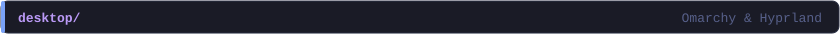
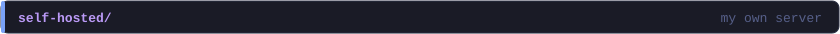
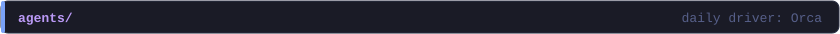
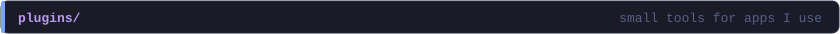
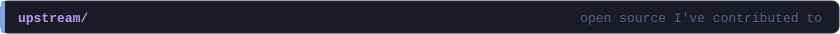
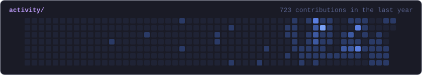

<picture>
  <source media="(prefers-color-scheme: dark)" srcset="assets/header-dark.svg">
  <source media="(prefers-color-scheme: light)" srcset="assets/header-light.svg">
  
</picture>

<picture>
  <source media="(prefers-color-scheme: dark)" srcset="assets/section-desktop-dark.svg">
  <source media="(prefers-color-scheme: light)" srcset="assets/section-desktop-light.svg">
  
</picture>

- [omaseafile](https://github.com/FelipeMayerDev/omaseafile) — Seafile in the bar: starts its own daemon and syncs libraries, no desktop client needed
- [omarchy-vesktop-theme](https://github.com/FelipeMayerDev/omarchy-vesktop-theme) — Vesktop follows the current Omarchy theme without restarting

<picture>
  <source media="(prefers-color-scheme: dark)" srcset="assets/section-self-hosted-dark.svg">
  <source media="(prefers-color-scheme: light)" srcset="assets/section-self-hosted-light.svg">
  
</picture>

- [fockytv](https://github.com/FelipeMayerDev/fockytv) — low-latency screen sharing: broadcast-box (WHIP/WHEP) in Docker + Electron client
- [Tailscale](https://tailscale.com) — private mesh network tying the home server, desktop and phone together
- [Hermes](https://github.com/NousResearch/hermes-agent) — always-on AI agent running on my own server

<picture>
  <source media="(prefers-color-scheme: dark)" srcset="assets/section-agents-dark.svg">
  <source media="(prefers-color-scheme: light)" srcset="assets/section-agents-light.svg">
  
</picture>

I live in [Orca](https://onorca.dev): every agent session, review and plugin below runs through it.

- [orca-walkthrough](https://github.com/FelipeMayerDev/orca-walkthrough) — Orca plugin: read a change in the order it makes sense, steps generated by your agents
- [omarchy-theme-sync](https://github.com/FelipeMayerDev/omarchy-theme-sync) — Orca's interface, editor and terminal follow the Omarchy theme in real time
- [second-brain](https://github.com/FelipeMayerDev/second-brain) — one technical memory shared by all my coding agents

<picture>
  <source media="(prefers-color-scheme: dark)" srcset="assets/section-plugins-dark.svg">
  <source media="(prefers-color-scheme: light)" srcset="assets/section-plugins-light.svg">
  
</picture>

- [flea-shrink-video](https://github.com/FelipeMayerDev/flea-shrink-video) — Flea plugin: shrink videos from the right-click menu, picking format, resolution, fps and quality
- [noctalia-custom-plugins](https://github.com/FelipeMayerDev/noctalia-custom-plugins) — custom plugins for Noctalia Shell

<picture>
  <source media="(prefers-color-scheme: dark)" srcset="assets/section-upstream-dark.svg">
  <source media="(prefers-color-scheme: light)" srcset="assets/section-upstream-light.svg">
  
</picture>

- [Omarchy](https://github.com/omacom/omarchy) — Z.ai GLM Coding Plan usage collector, brought into the AI usage panel ([#7566](https://github.com/omacom/omarchy/pull/7566) → [#14039](https://github.com/omacom/omarchy/pull/14039))
- [HarnessKit](https://github.com/RealZST/HarnessKit) — support for one more coding-agent harness ([#103](https://github.com/RealZST/HarnessKit/pull/103))
- [ZapFast](https://github.com/crmne/zapfast) — hide locked chats via upstream chat-lock events ([#55](https://github.com/crmne/zapfast/pull/55)), built on the chat-lock support I added to [whatsapp-rust](https://github.com/oxidezap/whatsapp-rust/pull/1507)

Plus small merged PRs to [waybar-ai-usage](https://github.com/NihilDigit/waybar-ai-usage/pull/11), [plasma-ai-usage-panel](https://github.com/gustavobragac/plasma-ai-usage-panel/pull/1) and [omarchy-discord](https://github.com/thisisgm/omarchy-discord/pull/1).

Also: [flounder](https://github.com/FelipeMayerDev/flounder) (couples' finances in Rust/egui) · [bangers](https://github.com/FelipeMayerDev/bangers) (3D village with proximity voice)

<picture>
  <source media="(prefers-color-scheme: dark)" srcset="assets/activity-dark.svg">
  <source media="(prefers-color-scheme: light)" srcset="assets/activity-light.svg">
  
</picture>

<picture>
  <source media="(prefers-color-scheme: dark)" srcset="assets/footer-dark.svg">
  <source media="(prefers-color-scheme: light)" srcset="assets/footer-light.svg">
  
</picture>
